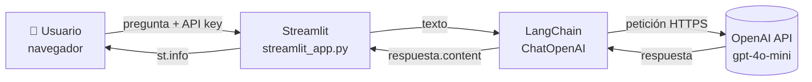
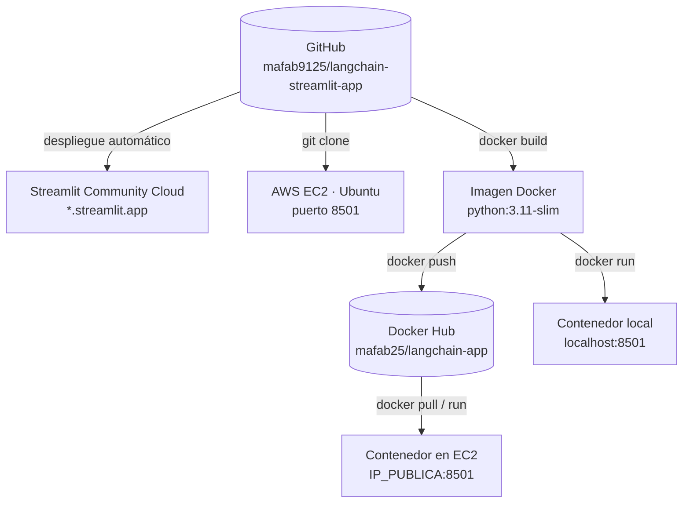

# 🦜🔗 LangChain + Streamlit Quickstart App

Aplicación web sencilla que permite hacerle preguntas a un modelo de lenguaje de OpenAI. La interfaz está construida con **Streamlit** y la comunicación con el modelo se hace a través de **LangChain**. El proyecto se despliega en tres entornos: **Streamlit Community Cloud**, una máquina **AWS EC2** y un **contenedor Docker**.

> Proyecto del Seminario de Profundización — Maestría en Ciencia de Datos 2025-2026.

---

## 🌐 Demo en línea

- **Streamlit Community Cloud:** https://langchain-app-appgit-fgwrxxb6vofpyklwehebqp.streamlit.app
- **Imagen Docker:** [`mafab25/langchain-app`](https://hub.docker.com/r/mafab25/langchain-app)

Para usarla necesitas tu propia **API key de OpenAI** (empieza por `sk-`). Se pega en la barra lateral de la app.

---

## ⚙️ ¿Cómo funciona?

1. El usuario escribe su API key de OpenAI en la barra lateral.
2. Escribe una pregunta en el área de texto y presiona **Submit**.
3. Streamlit le pasa el texto a LangChain.
4. LangChain envía la pregunta al modelo de OpenAI (`gpt-4o-mini`) y recibe la respuesta.
5. Streamlit muestra la respuesta en un recuadro azul.

## 🏗️ Arquitectura



### Entornos de despliegue



---

## 🧰 Tecnologías

| Herramienta | Uso |
|---|---|
| **Python 3.11** | Lenguaje del proyecto |
| **Streamlit** | Interfaz web (título, barra lateral, formulario, recuadro de respuesta) |
| **LangChain** + **langchain-openai** | Conexión con el modelo de lenguaje (`ChatOpenAI`) |
| **OpenAI API** | Modelo `gpt-4o-mini` que genera las respuestas |
| **Docker** | Empaquetado de la app en un contenedor |
| **Streamlit Community Cloud** | Despliegue gratuito y público |
| **AWS EC2** | Despliegue en un servidor Linux propio |

---

## 📁 Estructura del repositorio

```
langchain-streamlit-app/
├── streamlit_app.py   # Código de la aplicación
├── requirements.txt   # Librerías de Python necesarias
├── Dockerfile         # Instrucciones para construir la imagen Docker
├── .dockerignore      # Archivos que no se copian a la imagen
├── .gitignore         # Archivos que no se suben a GitHub
└── README.md          # Este archivo
```

---

## 💻 Ejecutar localmente

**Requisitos:** Python 3.10 o superior.

```bash
# 1. Clonar el repositorio
git clone https://github.com/mafab9125/langchain-streamlit-app.git
cd langchain-streamlit-app

# 2. Crear y activar un entorno virtual
python -m venv venv
venv\Scripts\activate          # Windows
# source venv/bin/activate     # Mac / Linux

# 3. Instalar dependencias
pip install -r requirements.txt

# 4. Ejecutar la app
streamlit run streamlit_app.py
```

Abre **http://localhost:8501** en el navegador.

---

## 🐳 Ejecutar con Docker

**Opción A — Construir la imagen desde el código:**

```bash
docker build -t langchain-app .
docker run -d -p 8501:8501 --name miapp langchain-app
```

**Opción B — Usar la imagen publicada en Docker Hub:**

```bash
docker pull mafab25/langchain-app:latest
docker run -d -p 8501:8501 --name miapp mafab25/langchain-app:latest
```

Abre **http://localhost:8501**.

Comandos útiles:

| Acción | Comando |
|---|---|
| Ver contenedores activos | `docker ps` |
| Ver logs | `docker logs miapp` |
| Detener | `docker stop miapp` |
| Iniciar de nuevo | `docker start miapp` |
| Eliminar | `docker rm -f miapp` |

---

## ☁️ Despliegues

### 1. Streamlit Community Cloud
1. Subir el código a GitHub.
2. En [share.streamlit.io](https://share.streamlit.io) → **Create app**.
3. Repositorio `mafab9125/langchain-streamlit-app`, rama `main`, archivo `streamlit_app.py`.
4. **Deploy**. Cada `git push` a `main` actualiza la app automáticamente.

### 2. AWS EC2
1. Lanzar una instancia **Ubuntu Server 24.04 LTS** (`t2.micro` / `t3.micro`).
2. En el *Security Group*, abrir el puerto **22** (SSH) y el **8501** (Custom TCP, 0.0.0.0/0).
3. Conectarse por EC2 Instance Connect y ejecutar:

```bash
sudo apt update
sudo apt install -y python3-pip python3-venv git
git clone https://github.com/mafab9125/langchain-streamlit-app.git
cd langchain-streamlit-app
python3 -m venv venv
source venv/bin/activate
pip install -r requirements.txt
nohup streamlit run streamlit_app.py --server.port 8501 --server.address 0.0.0.0 > app.log 2>&1 &
```

4. Abrir `http://IP_PUBLICA_EC2:8501`.

### 3. Docker en AWS EC2
```bash
sudo apt install -y docker.io
sudo usermod -aG docker ubuntu     # luego salir y volver a entrar
docker run -d -p 8501:8501 --name miapp --restart unless-stopped mafab25/langchain-app:latest
```

---

## 🔒 Seguridad

- La **API key no está en el código**. Cada usuario la ingresa en la barra lateral y el campo la oculta (`type="password"`).
- `.gitignore` evita subir el entorno virtual y archivos de secretos (`.env`, `.streamlit/secrets.toml`).
- La imagen Docker no contiene credenciales.

---

## 📝 Nota sobre el tutorial original

Este proyecto se basa en el tutorial [*LangChain tutorial #1: Build an LLM-powered app in 18 lines of code*](https://blog.streamlit.io/langchain-tutorial-1-build-an-llm-powered-app-in-18-lines-of-code-384a87016d0a) (2023). El código se **actualizó a la versión actual de LangChain**:

| Tutorial original (2023) | Este proyecto |
|---|---|
| `from langchain.llms import OpenAI` | `from langchain_openai import ChatOpenAI` |
| `llm(input_text)` | `llm.invoke(input_text).content` |
| `requirements`: `openai`, `langchain` | `requirements`: `langchain`, `langchain-openai` |
| API key visible al escribir | Campo tipo contraseña |

---

## 📚 Referencias

- [Tutorial LangChain + Streamlit (Streamlit Blog)](https://blog.streamlit.io/langchain-tutorial-1-build-an-llm-powered-app-in-18-lines-of-code-384a87016d0a)
- [Documentación de LangChain](https://docs.langchain.com/oss/python/langchain/overview)
- [Documentación de Streamlit](https://docs.streamlit.io)
- [Documentación de Docker](https://docs.docker.com)
